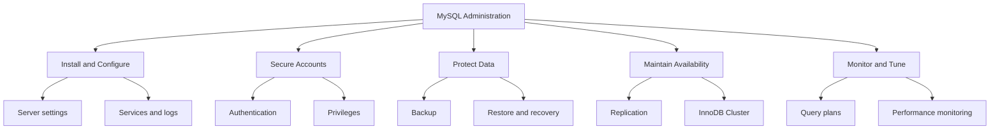
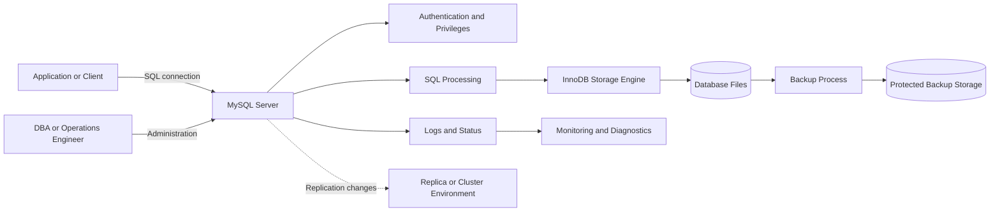
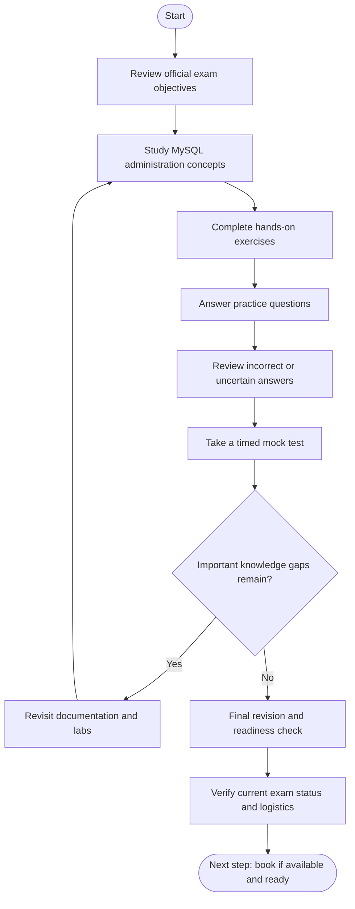
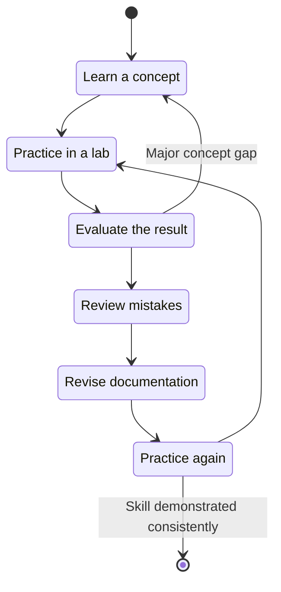
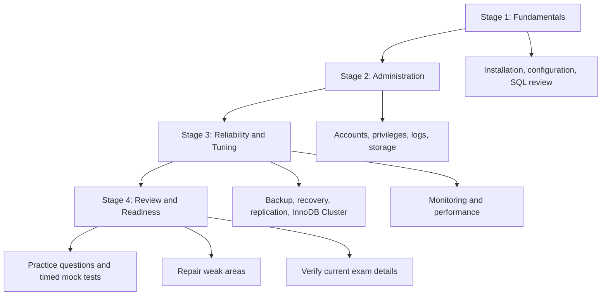

# Oracle MySQL 8.0 Database Administrator (1Z0-908) — Study Guide

A practical learning resource for database administrators preparing for Oracle's **MySQL 8.0 Database Administrator (1Z0-908)** certification exam. This guide organizes core MySQL administration topics into a structured study plan with technical diagrams, hands-on exercises, original practice questions, and revision strategies.

- Official learning path: [CertsGate](https://certsgate.com/)

## Table of Contents

- [About the Certification](#about-the-certification)
- [Who Should Use This Guide?](#who-should-use-this-guide)
- [Exam Status and Details](#exam-status-and-details)
- [Core Skills and Study Areas](#core-skills-and-study-areas)
- [Conceptual Skills Map](#conceptual-skills-map-not-official-exam-weighting)
- [MySQL Administration Architecture](#mysql-administration-architecture)
- [Preparation Flowchart](#preparation-flowchart)
- [The Iterative Study Cycle](#the-iterative-study-cycle)
- [Step-by-Step Preparation Guide](#step-by-step-preparation-guide)
- [Suggested Study Roadmap](#suggested-study-roadmap)
- [Practice Questions](#practice-questions)
- [Hands-On Labs and Projects](#hands-on-labs-and-projects)
- [Common Preparation Mistakes](#common-preparation-mistakes)
- [Career Relevance](#career-relevance)
- [Frequently Asked Questions](#frequently-asked-questions)
- [Official and Additional Resources](#official-and-additional-resources)
- [About CertsGate](#about-certsgate)

## About the Certification

The 1Z0-908 exam is associated with Oracle's MySQL 8.0 Database Administrator certification path. Its subject matter is relevant to professionals who install, configure, secure, maintain, monitor, and troubleshoot MySQL database environments.

Database administration involves more than knowing SQL syntax. A DBA must understand server configuration, account privileges, backup and recovery, replication, availability, and performance. These responsibilities connect directly to the reliability of applications that depend on the database.

**Version awareness matters.** This guide focuses on MySQL 8.0 administration concepts associated with 1Z0-908. Some commands and procedures can vary by MySQL release, operating system, deployment model, and configuration. Always check the documentation for the version you are using.

## Who Should Use This Guide?

This repository is intended for:

- Aspiring MySQL database administrators.
- IT professionals who maintain applications backed by MySQL.
- System administrators expanding into database operations.
- Developers who want a stronger understanding of database reliability.
- Experienced MySQL users who need a structured review of administration topics.

You will benefit from basic SQL knowledge and familiarity with command-line tools, operating-system services, networking, and database concepts. If you are new to MySQL, begin with installation, schemas, users, tables, and basic queries before moving to operational administration.

## Exam Status and Details

| Item | Information |
|---|---|
| Certification provider | Oracle |
| Exam code | 1Z0-908 |
| Exam name | MySQL 8.0 Database Administrator |
| Product focus | MySQL 8.0 administration |
| Published retirement date | November 16, 2026, according to Oracle's learning path |
| Current registration and availability | Verify through Oracle MyLearn |
| Current exam objectives and scoring details | Check the current official exam page |

Oracle's MyLearn catalog has listed a two-hour exam and multiple-choice format for 1Z0-908. Confirm the details directly with Oracle before booking; exam policies and availability can change.

**Planning recommendation:** Since the published retirement date is approaching, confirm whether you can still register and sit the exam in time. If not, review Oracle's replacement MySQL Database Administration Professional learning path before deciding which objectives and resources to prioritize.

## Core Skills and Study Areas

Use the following areas as a practical revision checklist. They reflect MySQL administration skills associated with the learning path and are **not a substitute for the official exam objective list**.

### 1. Installation and Configuration

Learn how to install MySQL Server, inspect its configuration, start and stop the service, and verify that it is accepting connections.

Practice:
- Locating and understanding server configuration files.
- Checking server status and error logs.
- Connecting with the MySQL client.
- Identifying configuration differences between environments.

### 2. User and Security Administration

Understand authentication, account management, privileges, and least-privilege access.

Practice:
- Creating accounts for different application roles.
- Granting only the permissions each account needs.
- Inspecting privileges and testing access.
- Reviewing secure connection and credential-handling practices.

### 3. Backup and Recovery

A backup is useful only when it can be restored successfully. Learn the differences between logical and physical backups, and understand how recovery requirements affect backup design.

Practice:
- Creating a logical backup with `mysqldump`.
- Restoring a database into a test environment.
- Checking backup completeness.
- Documenting recovery steps and validating the restored data.

### 4. Replication and High Availability

Understand how MySQL replication moves changes from a source to replicas, how replication status is inspected, and how replication differs from a complete high-availability solution.

Practice:
- Explaining source and replica roles.
- Reading replication status and error information.
- Identifying likely causes of replication lag.
- Understanding the purpose of InnoDB Cluster and its components.

### 5. InnoDB and Storage

Review InnoDB's role as a transactional storage engine, along with indexes, transactions, locking, and storage considerations.

Practice:
- Creating and examining indexes.
- Explaining transaction commit and rollback.
- Identifying how poor indexing can increase query cost.
- Understanding how storage configuration affects operational behavior.

### 6. Monitoring and Performance Tuning

Learn how to inspect server activity, interpret slow queries, and use execution plans to investigate performance problems.

Practice:
- Using `EXPLAIN` to inspect a query plan.
- Reviewing slow-query information.
- Looking for missing or unsuitable indexes.
- Measuring changes before and after a tuning adjustment.

## Conceptual Skills Map (Not Official Exam Weighting)

Oracle's current official domain percentages were not independently confirmed for this guide. The diagram below groups related administration skills for learning purposes only. It does not represent official exam weightings.

Use this map to identify subjects that need hands-on practice. For official exam objectives, refer to the Oracle learning path linked above.

## MySQL Administration Architecture

The following conceptual diagram shows how an application, MySQL server, storage engine, backup process, monitoring tools, and replication environment fit together. It is an educational overview, not a mandatory topology for every deployment.

### How to Read the Diagram

- **Application or client:** Sends database requests over a configured connection.
- **Authentication and privileges:** Determine whether an account can connect and which actions it may perform.
- **SQL processing:** Handles incoming statements and coordinates execution.
- **InnoDB:** Provides transactional storage capabilities for tables using this engine.
- **Logs and monitoring:** Help administrators identify errors, resource pressure, and performance issues.
- **Backup storage:** Holds recoverable copies that should be protected independently from the live database.
- **Replication or cluster environment:** Supports different availability and scaling designs depending on the chosen architecture.

A useful administration exercise is to trace one operation through the system: a client submits a query, the server checks permissions, the statement executes, the storage engine accesses data, and operational tools provide evidence of what happened.

## Preparation Flowchart

Follow this preparation process, but repeat the review stages whenever your practice results reveal a knowledge gap.

## The Iterative Study Cycle

Database administration skills develop through repetition. Read about a feature, configure it in a safe environment, test whether it works, investigate failures, and repeat the exercise until you can explain the outcome.

Do not treat a correct answer as proof of mastery by itself. Explain why the solution works, what alternative approaches exist, and which operational risks matter.

## Step-by-Step Preparation Guide

### Step 1: Confirm the Exam You Need

Start at Oracle MyLearn and confirm the current status of 1Z0-908. Check the retirement notice, registration availability, current learning path, and any replacement certification. Do this before following an older study plan.

### Step 2: Establish Your Baseline

Review the official objectives and mark each area as:
- **Strong:** You can explain the concept and demonstrate it.
- **Developing:** You understand the theory but need practice.
- **Weak:** You need to revisit the documentation and repeat the lab.

This makes your study time more focused than reading every topic at the same pace.

### Step 3: Build a Safe Lab

Use a local or otherwise authorized test environment. Avoid experimenting on production systems.

Set up a MySQL instance, create a sample database, configure accounts, run queries, and inspect logs. Where appropriate, use a separate test instance for backup restoration or replication experiments.

### Step 4: Learn Operational Workflows

For each subject, practice the full workflow rather than memorizing isolated commands. For example, backup preparation should include creating the backup, checking its output, restoring it into a test environment, and confirming that the restored data is usable.

### Step 5: Use Practice Questions for Diagnosis

Use original practice questions and reputable study materials to uncover gaps. After each question, explain the reasoning behind the answer and identify the related objective.

Supplementary resources such as [CertsGate](https://certsgate.com/) can help you check your understanding. Use them alongside Oracle documentation and hands-on exercises, not as replacements for either.

### Step 6: Review Mistakes Systematically

Keep a simple error log:

| Topic | Mistake | Next action |
|---|---|---|
| Privileges | Granted more access than required | Repeat a least-privilege lab |
| Backup and restore | Did not verify the restored database | Perform a complete restore test |
| Replication | Misread status output | Revisit replication monitoring documentation |
| Performance | Assumed an index would always help | Compare execution plans and test results |

Update this table as you work. Revisit recurring errors before taking another mock test.

## Suggested Study Roadmap

This is a flexible four-stage plan, not an official Oracle schedule. Adjust it to your experience and the time remaining before the exam's published retirement date.

| Stage | Main focus | Evidence of progress |
|---|---|---|
| 1. Fundamentals | MySQL architecture, setup, configuration | You can install or inspect a test instance |
| 2. Administration | Users, privileges, logs, storage | You can complete common admin tasks safely |
| 3. Reliability and tuning | Backups, recovery, replication, performance | You can demonstrate and troubleshoot workflows |
| 4. Readiness | Practice questions and targeted revision | You can explain answers and repeat key labs |

If you are starting close to the retirement date, prioritize confirming exam availability and the appropriate certification path first. Do not rush through technical labs simply to follow a calendar.

## Practice Questions

The following are **original learning questions**, not actual or official Oracle exam questions. They are intended to help you check core concepts.

### Question 1: Least-Privilege Access

An application account needs to read records from one database but should not create users or modify server configuration. What is the best general approach?

A. Grant administrative privileges to avoid permission errors.  
B. Use a dedicated account and grant only the required database permissions.  
C. Share the DBA account with the application.  
D. Disable authentication for the application.

**Answer: B.** A dedicated account with narrowly scoped permissions reduces the impact of compromised credentials and accidental misuse.

### Question 2: Backup Validation

A logical backup command finishes without displaying an obvious error. What is the most reliable next step before treating the backup as recoverable?

A. Assume it is valid because the command completed.  
B. Delete the source database to test the backup.  
C. Restore it in an isolated test environment and verify the recovered data.  
D. Rename the backup file.

**Answer: C.** A restore test verifies that the backup can be read and used to recover the expected data.

### Question 3: Query Performance

A query becomes slow after the table grows significantly. Which action is a useful starting point?

A. Add indexes to every column immediately.  
B. Inspect the query plan and investigate filtering, joins, and index usage.  
C. Disable account permissions.  
D. Restart the server after every query.

**Answer: B.** Query plans and measured behavior provide evidence for deciding whether indexing or a different query strategy may help.

### Question 4: Replication Troubleshooting

A replica is behind its source. What should you do first?

A. Assume the data is permanently lost.  
B. Inspect replication status, errors, lag, and relevant server resources.  
C. Delete the replica's data directory.  
D. Disable all logging.

**Answer: B.** Diagnose the actual state before making changes. Replication lag can have several causes, and recovery steps depend on the evidence.

### How to Use Practice Questions

1. Answer before reading the explanation.
2. Explain why each alternative is right or wrong.
3. Link the question to an objective or documentation topic.
4. Repeat a lab related to any uncertain answer.
5. Revisit the question later to check retention.

A mock test is useful for identifying weak areas and practicing time management. It cannot guarantee an exam result, and third-party material should not be assumed to reproduce official exam content.

## Hands-On Labs and Projects

Practical exercises make administration concepts easier to remember. Use disposable test data and document your results.

### Project 1: Secure a MySQL Instance

**Goal:** Practice account management and permissions.

Tasks:
1. Create a sample database and table.
2. Create a dedicated application user.
3. Grant only the permissions required for the exercise.
4. Test permitted and denied operations.
5. Document how you would review and revoke access.

### Project 2: Backup and Restore Drill

**Goal:** Demonstrate a basic recovery workflow.

Tasks:
1. Create a small sample database with known records.
2. Create a logical backup using `mysqldump`.
3. Restore the backup into a separate test database or instance.
4. Compare table counts and representative records.
5. Record the commands, validation steps, and any limitations.

Never test recovery by destroying a production database.

### Project 3: Query Performance Investigation

**Goal:** Learn to measure before tuning.

Tasks:
1. Create a table with representative test data.
2. Run a query with a filtering condition.
3. Inspect its execution plan with `EXPLAIN`.
4. Test a suitable index when the evidence supports it.
5. Compare the execution plans and observed performance.

Avoid assuming that every index improves performance. Indexes consume storage and can add overhead to writes.

### Project 4: Replication Concepts

**Goal:** Understand source/replica behavior.

Tasks:
1. Read the official replication documentation.
2. Set up a replication lab only if you have suitable test infrastructure.
3. Inspect status information and identify common error categories.
4. Observe how changes propagate to a replica.
5. Document how you would investigate lag or a stopped replication process.

### Project 5: InnoDB Cluster Learning Exercise

**Goal:** Understand the components and purpose of MySQL high availability.

Tasks:
1. Read the official InnoDB Cluster overview.
2. Identify the roles of MySQL Server, Group Replication, and MySQL Router.
3. Draw the expected application connection path.
4. Explain how the design differs from a single standalone server.
5. If a lab is available, follow Oracle's version-specific deployment instructions.

## Common Preparation Mistakes

- **Ignoring the retirement notice:** Verify the exam's availability and replacement path before scheduling study time.
- **Memorizing commands without understanding them:** Learn what a command changes, what output to expect, and how to verify success.
- **Skipping restore tests:** A backup that has never been restored is not fully validated.
- **Treating replication as a complete backup strategy:** Replication and backups address different operational needs.
- **Granting excessive privileges:** Use least privilege and test access deliberately.
- **Tuning without evidence:** Inspect query plans and measure results before changing indexes or server settings.
- **Ignoring version differences:** Confirm that commands and procedures apply to the MySQL release in your lab.
- **Repeating practice questions without reviewing mistakes:** Use every incorrect answer to identify a concept that needs more work.

## Career Relevance

MySQL administration skills are relevant to database administration, application operations, backend engineering, platform support, and infrastructure roles. Practical knowledge of backups, permissions, replication, monitoring, and troubleshooting helps teams maintain data availability and operational reliability.

A certification can provide a structured way to review these skills, but it does not replace hands-on experience. Keep lab notes, scripts, diagrams, and troubleshooting records that demonstrate what you can actually do.

## Frequently Asked Questions

### What is the 1Z0-908 exam?

It is Oracle's MySQL 8.0 Database Administrator exam. Consult Oracle's official learning path for the current description and status.

### Is the exam still available?

Oracle's learning path states that 1Z0-908 retires on **November 16, 2026**. Availability can depend on Oracle's current registration arrangements, so verify directly before booking.

### What should I study for 1Z0-908?

Start with Oracle's current exam objectives. Core administration study areas include installation and configuration, user security, backup and recovery, replication, InnoDB, monitoring, and performance tuning. Use the official objectives to decide which subjects apply to your exam.

### How long should I prepare?

The appropriate time depends on your current MySQL experience, available study time, and hands-on practice. Establish a baseline, focus on weak areas, and assess readiness through practical tasks and practice questions rather than relying on a fixed number of days.

### Are the practice questions in this repository official?

No. The sample questions are original educational material. They are not represented as actual, leaked, or official Oracle exam questions.

### Can CertsGate replace Oracle documentation?

No. CertsGate is an independent supplementary preparation resource. Use official Oracle documentation for authoritative technical information and exam details.

### What if I cannot take 1Z0-908 before retirement?

Review Oracle's current MySQL Database Administration Professional learning path and verify the replacement certification's objectives and requirements. Do not assume the replacement has identical exam content or policies.

## Official and Additional Resources

Use official Oracle sources for product behavior, supported commands, exam details, and learning paths.

| Resource | Purpose |
|---|---|
| [Oracle MySQL 8.0 Database Admin learning path](https://learn.oracle.com/ols/learning-path/become-a-mysql-80-database-admin-professional/118071/97589) | Official learning path and retirement notice for 1Z0-908 |
| [Oracle MySQL Documentation](https://dev.mysql.com/doc/) | Product manuals and version-specific technical reference |
| [MySQL 8.0 Reference Manual](https://dev.mysql.com/doc/refman/8.0/en/) | Server administration, SQL, security, replication, and other MySQL 8.0 topics |
| [MySQL 8.0 Replication](https://dev.mysql.com/doc/refman/8.0/en/replication.html) | Replication concepts and configuration |
| [MySQL 8.0 Backup and Recovery](https://dev.mysql.com/doc/refman/8.0/en/backup-and-recovery.html) | Backup methods and recovery guidance |
| [MySQL InnoDB Cluster](https://dev.mysql.com/doc/mysql-shell/8.0/en/mysql-innodb-cluster.html) | InnoDB Cluster concepts and administration |
| [Oracle Training and Certification](https://www.oracle.com/education/training/) | Oracle training and certification information |
| [CertsGate](https://certsgate.com/) | Independent certification preparation resources |

Documentation is version-specific. If you use a newer MySQL release or a managed database service, confirm the differences before applying a procedure from the MySQL 8.0 manual.

## About CertsGate

[CertsGate](https://certsgate.com/) is an independent IT certification preparation website. Learners can explore relevant study guides, practice questions, mock tests, and other preparation materials to support their revision.

For 1Z0-908 preparation, use supplementary questions to check your understanding of MySQL administration concepts, then return to the official documentation and lab environment to validate what you learned. Always verify that third-party material matches the exam version and current objectives you intend to pursue.

CertsGate is not presented here as an official Oracle certification provider or partner.
